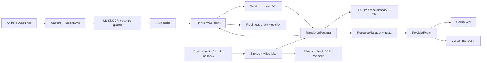

# Kiến trúc Gemini OCR

## Phạm vi

Khảo sát ngày **28/10/2026**, checkout root tại commit `529635b` (`main`). Mã Gradle khai báo **1.7.1 / code 16**. Ghi chú `docs/RELEASE_PRIORITY.md` đang chưa commit mô tả 1.7.5 ở `build/priority-release-1.7.5/`; mã/binary ở đó chưa được khảo sát. Không suy ra checkout này có các tính năng của bản bàn giao hoặc 1.8.0. Theo remote-tracking local, `main` chậm 2 commit; không fetch/pull hoặc tích hợp trong đợt này.

Chỉ khảo sát source/config/test thuộc repository này. Không coi thư mục `MovieTranslatorEngine` ngoài repo là module đã tích hợp. Các worktree khác được giữ nguyên. Kết quả chạy hiện tại nằm tại [TESTING.md](TESTING.md); báo cáo phiên bản cũ là lịch sử.

## Ranh giới thực tế

| Thành phần | Trách nhiệm và giới hạn |
|---|---|
| [android-app](android-app/settings.gradle.kts) | Chỉ **một Gradle module `:app`**; capture/network/ocr/overlay/settings là package, chưa phải module build độc lập. Không có video engine riêng trong Android. |
| [windows-server/app](windows-server/app) | Package Python: FastAPI, engine dịch, SQLite, TM, scheduler, subtitle và video jobs. Chưa có package Translation Engine độc lập. |
| [windows-server/static](windows-server/static) | Giao diện Companion HTML/CSS/JavaScript, dùng API quản trị. |
| [shared](shared) | Mô tả protocol và schema translate JSON; không phải mã sinh tự động dùng chung hai nền tảng. |
| [scripts](scripts), [tests](tests), [research](research) | Công cụ build/kiểm chứng, regression Python, thử nghiệm tách khỏi ứng dụng. Local translation trong research chưa phải backend production. |

## Luồng chính

**Live:** [MainActivity](android-app/app/src/main/java/com/gemini/ocr/MainActivity.kt) nhận consent → [ScreenCaptureService](android-app/app/src/main/java/com/gemini/ocr/capture/ScreenCaptureService.kt) tạo VirtualDisplay/ImageReader → mailbox `Channel(1, DROP_OLDEST)` → một consumer [OcrProcessor](android-app/app/src/main/java/com/gemini/ocr/ocr/OcrProcessor.kt) → ROI/source rows/stability/debounce → RAM cache hoặc [TranslationClient](android-app/app/src/main/java/com/gemini/ocr/network/TranslationClient.kt) → Windows. Khi về, kiểm request/region/generation; chế độ tự động còn cần snapshot OCR sau response trước khi [vẽ overlay](android-app/app/src/main/java/com/gemini/ocr/overlay/TranslationOverlay.kt). Chế độ 1 KHUNG vẽ trên frame đã chọn. Native OCR phải sở hữu bitmap đến khi task hoàn tất.

**Windows:** [launcher](windows-server/launcher.py) tạo [Runtime](windows-server/app/server.py) gồm Store, TLS/pairing, ProviderRouter, TranslationManager, subtitle/video services. Device API TLS mặc định LAN `8765` có `/health`, `/v1/pair`, `/v1/stream`; admin HTTP chỉ loopback `8766`. Không gửi ảnh màn hình từ Android để dịch.

**Dịch:** [TranslationManager._translate](windows-server/app/manager.py) chụp revision/settings → chuẩn hóa NFKC/whitespace → glossary exact → TM được phép tái sử dụng → hash cache → singleflight/dedup → ưu tiên tài nguyên/quota → provider. Kiểm revision trước ghi kết quả, chỉ cập nhật context khi request còn hiện hành. Namespace chứa provider/ngôn ngữ/profile/mode/model/glossary; không gộp câu khác phủ định/số/dấu câu chỉ vì gần giống.

**Bộ nhớ:** [StableText.kt](android-app/app/src/main/java/com/gemini/ocr/capture/StableText.kt) chứa cả `StableText` và `TranslationMemory` RAM Android. [translation_memory.py](windows-server/app/translation_memory.py) là kho Windows có queue ghi giới hạn, opt-in và chất lượng Draft/verified/user_approved. Chỉ verified/user_approved được lookup; AI không ghi đè User Approved. SQLite cache và TM có mục đích/điều kiện lưu khác nhau.

**Dịch trước phụ đề:** [subtitle_import](windows-server/app/subtitle_import.py) parse SRT/VTT/ASS/SSA, kiểm tra toàn file, gộp exact text, chia batch giới hạn → [subtitle_jobs](windows-server/app/subtitle_jobs.py) dùng API chính thức và namespace Live để prewarm cache, nhường Live; không ghi TM. Preview không gọi provider.

**Video:** [video_jobs](windows-server/app/video_jobs.py) quản lý project/checkpoint/timeline, dùng [video_media](windows-server/app/video_media.py) probe/extract/export, [video_ocr](windows-server/app/video_ocr.py) RapidOCR và [video_speech](windows-server/app/video_speech.py) faster-whisper. `auto` ưu tiên embedded text; nếu thiếu, tiếng Hàn đi speech, ngôn ngữ khác OCR; OCR rỗng có audio mới fallback speech. OCR video tiếng Hàn bị chặn; embedded image subtitles chưa được OCR. Dịch bằng API chính thức; mặc định private, không dùng cache/context chung; việc lưu TM cần điều kiện opt-in. Xuất SRT/ASS/MP4 giữ tệp nguồn; subprocess nhường tài nguyên cho Live.

## Cập nhật batch Android 1.8.12 — 10/11/2026

Phần khảo sát 28/10 ở trên là lịch sử. Source hiện tại khai báo 1.8.12 / 37, chứa thay đổi chưa commit được chủ dự án bàn giao để tích hợp có kiểm soát. Luồng Android hiện dùng `BatchJobs` → `BatchEpisodePipeline` → `VideoJobs`: một lane nguồn EXTRACT/CLEAN, các lane riêng TRANSLATE/POLISH/FINISH. Channel chỉ truyền project ID, không chuyển video/frame/timeline. Không có queue thứ hai hoặc thay backend. Mỗi tập qua đầy đủ stage độc lập; giữ checkpoint/cache/private scope của worker cũ.

Reservation bao trùm các lane đến sau cancellation cleanup; cùng project ID không được xử lý bởi hai lane. `BatchStore` và `VideoStore` tiếp tục AtomicFile, không migration dữ liệu. Foreground-service redelivery phục hồi chỉ batch RUNNING/RETRY_WAIT; các trạng thái người dùng đã dừng không tự chạy lại. Playback hiện đi từ listener `VideoPreview` đến admission trích xuất và API; Live vẫn có gate cũ. Hợp đồng chi tiết ở [BATCH_STAGED_PIPELINE.md](docs/BATCH_STAGED_PIPELINE.md); bằng chứng chạy và giới hạn môi trường ở [TESTING.md](TESTING.md).

## Hợp đồng và độ lệch tài liệu

- Schema request: [models.py](windows-server/app/models.py), [protocol.json](shared/protocol.json); hai phía thực thi tại [server.py](windows-server/app/server.py) và TranslationClient. Schema JSON không bao phủ mọi control message/capability.
- [PROTOCOL.md](shared/PROTOCOL.md) mô tả `latest_only` một active + một pending, phù hợp đường CLI. Mã hiện tại còn quảng bá `api_latest_parallel_v1`/`capture_state_v1`: đường API có tối đa hai workers, cache probe và chặn stale response. Khi sửa protocol, đối chiếu cả hai phía và capability fallback; không chép mô tả cũ thành quy tắc chung.
- API là đường chính thức; AntigravityProvider kế thừa GeminiCliProvider vẫn tồn tại sau cờ `personal_cli_enabled` mặc định false. Không xóa đường tương thích hoặc tự bật cờ khi sửa tính năng khác.
- Auth, storage namespace, generation guards và priority là ranh giới bắt buộc giữ. Xem quy tắc tại [AGENTS.md](AGENTS.md), vị trí/test tại [MODULE_INDEX.md](MODULE_INDEX.md).

## Điểm cần cải thiện theo từng đợt

Số dòng vật lý tại commit khảo sát; kích thước chỉ giúp định vị, không chứng minh lỗi hoặc số token. Chưa có bằng chứng cần viết lại ứng dụng.

| Bằng chứng | Hệ quả | Bước nhỏ trong tác vụ riêng sau này |
|---|---|---|
| ScreenCaptureService 696 dòng; `captureLoop`, `sendLatest`, `onMessage`, `renderCurrent` và nhiều state cùng lớp | Thay pipeline cần đọc nhiều trạng thái | Chốt bảng trạng thái/test freshness trước; chỉ trích một trách nhiệm mỗi patch. |
| `capture` dùng `overlay`, overlay dùng `capture.SubtitleRegion`; nhiều lớp cùng mutable `SessionState` | Package phụ thuộc hai chiều, khó kiểm thử độc lập | Xác định ownership state và seam hành vi trước khi tách; chưa đổi interface. |
| `video_jobs.py` 573 dòng; `_run` kiêm extraction/dịch/checkpoint/TM | Tính năng video dễ chạm orchestration | Characterization tests rồi trích từng extraction adapter, giữ API/checkpoint. |
| `server.py` 532 dòng; `stream` chứa auth/mailbox/workers/cancel | Sửa scheduler dễ tác động nhiều đường transport | Bảng state/capability và test trước, trích scheduler trong patch riêng. |
| `video_media.py` 547 dòng gồm subprocess và định dạng subtitle | Export thuần phụ thuộc file điều phối process | Khi cần tính năng format mới, tách exporter có re-export tương thích. |
| `static/app.js` 61.389 byte / 324 dòng, nhiều dòng dài, nhiều trang/global state | Đếm dòng đánh giá thấp chi phí đọc | Tách từng trang khi có nhu cầu và test UI; không đổi DOM/API hàng loạt. |
| `TranslationManager._translate` và `VideoJobService._start` cùng dựng model/glossary namespace | Logic lặp có nguy cơ lệch identity | Helper thuần riêng, kiểm tra namespace trước/sau bằng regression; chưa gộp trong đợt này. |
| `video_jobs` đọc `manager.store.db/lock`, sửa `manager.contexts`; `subtitle_jobs` cũng pop contexts | Rò rỉ ownership persistence/context | Thêm phương thức count-project/context cleanup nhỏ trước khi di chuyển module. |
| `/api/memory` nằm trong `video_routes.py` | Tìm TM dễ sửa nhầm chỗ | Mục lục giải quyết ngay; cân nhắc tách router riêng với test auth/route. |
| Android tests lặp setup service/prefs/socket và dùng reflection vào private field | Tách service dễ làm gãy test theo implementation | Fixture/seam nhỏ sau khi giữ behavior assertions; không xóa test để refactor dễ hơn. |

Build Android dùng Gradle/AGP/Kotlin; Windows dùng Python requirements/PyInstaller. Không thấy workflow CI được tracked trong repository. Test mặc định chưa bao gồm các test harness ngoài `tests/`; cách chạy và các side effect được ghi một lần trong [TESTING.md](TESTING.md). Đợt này chỉ thêm tài liệu và checker, chưa thay mã ứng dụng/build hoặc thử kiến trúc.
